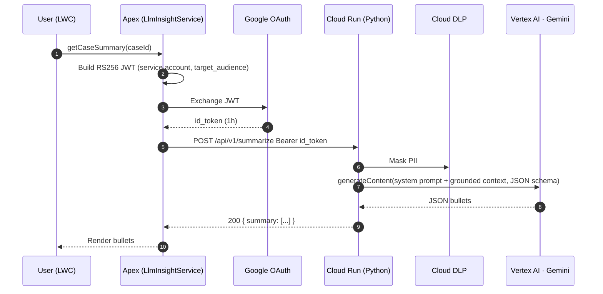
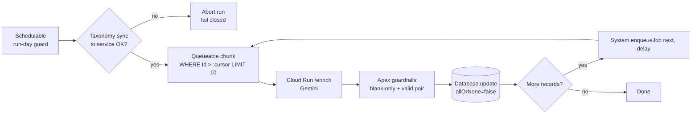

# Salesforce ⇄ Google Cloud LLM Integration

> Production-style reference architecture for bringing **Generative AI (Gemini on Vertex AI)** into
> Salesforce through a secure **Cloud Run** microservice — with PII masking, grounding, and
> hallucination guardrails.


This repository is a **clean-room showcase** I wrote to demonstrate integration patterns I use
professionally. It contains no employer code, endpoints, or data — all names and samples are generic.

---

## What it does

| Capability | How |
|---|---|
| **On-demand AI case summary** | LWC → `@AuraEnabled` Apex → Cloud Run `/api/v1/summarize` → Gemini → JSON bullets rendered in the record page |
| **Scheduled AI field enrichment** | Self-chaining, cursor-paginated **Queueable Apex** sends record notes to Cloud Run `/api/v1/enrich` and writes predictions back **only to blank fields** |
| **Hallucination gate** | Before each run, Apex pushes the **live picklist taxonomy** (incl. controlling → dependent pairs) to the service; the model may only choose from those values and Apex re-validates every pair before DML |
| **PII protection** | Cloud Run masks emails/phones/names (Cloud DLP in production, regex fallback here) **before** text reaches the LLM |
| **Zero secrets in code** | Apex mints a short-lived **Google identity token** from a certificate-signed **JWT**; config lives in a Hierarchy Custom Setting |

## Architecture





## Why a Cloud Run middle tier instead of calling the LLM from Apex?

1. **Governor limits** — long threads exceed Apex heap / 120 s callout limits; Python has none.
2. **PII compliance** — masking happens before the model sees data.
3. **Agility** — prompts and model versions change with a Cloud Run revision, not a Salesforce release.
4. **Resilience** — the service can spread calls across Vertex regions to avoid regional `429`s.

## Key engineering decisions

- **Keyset cursor (`WHERE Id > :lastId ORDER BY Id`)** instead of offset — guarantees termination even
  when some records can never be filled.
- **Self-paced Queueable chain** (`System.enqueueJob(job, delayMinutes)`) instead of `Database.Batchable`,
  so the external AI endpoint is never flooded.
- **Fail-closed taxonomy gate** — if the picklist sync fails, nothing runs.
- **Blank-only writes** — AI never overwrites human-entered data.
- **Structured output** — `response_mime_type: application/json` + low temperature for deterministic parsing.
- **Errors are logged, never thrown mid-chain** — one bad record cannot stop the run.

## Repository layout

```
force-app/main/default/
  classes/   GcpAuthService · LlmInsightService · AiFieldEnrichmentJob · AiServiceClient
             TaxonomyProvider · tests + AiServiceMock (HttpCalloutMock)
  lwc/       aiCaseSummary
  objects/   AI_Service_Settings__c (Hierarchy Custom Setting) · Account risk fields
cloud-run/
  main.py · llm.py · masking.py · prompts.py · requirements.txt · Dockerfile
```

## Run it

**Salesforce**
```bash
sf org login web --alias dev
sf project deploy start --target-org dev
sf apex run test --class-names LlmInsightServiceTest --class-names AiFieldEnrichmentJobTest --target-org dev --code-coverage
```
Upload a certificate for your GCP service account in *Setup → Certificate and Key Management*, then
populate `AI_Service_Settings__c` (org default).

**Cloud Run**
```bash
cd cloud-run
gcloud run deploy ai-insights --source . --region us-central1 --no-allow-unauthenticated \
  --set-env-vars GCP_PROJECT=<project>,GEMINI_MODEL=gemini-2.5-flash
gcloud run services add-iam-policy-binding ai-insights \
  --member=serviceAccount:<sa-email> --role=roles/run.invoker --region us-central1
```

## License

MIT © Naman G Shetty
